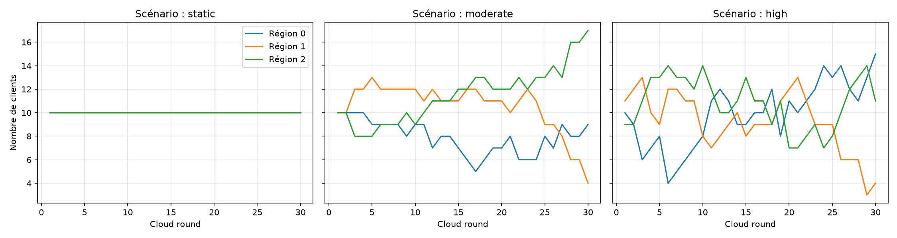
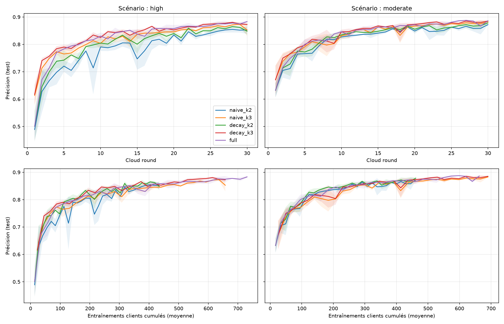
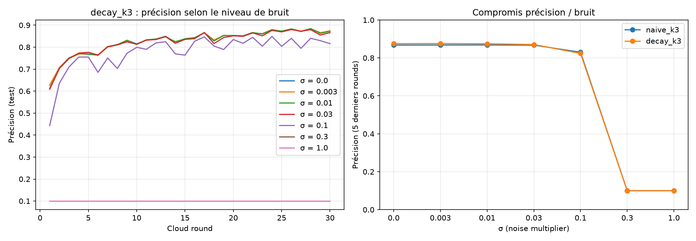

# Staleness-aware aggregation for hierarchical federated learning on dynamic Edge topologies

A small, reproducible simulation study (PyTorch) of **Client → Edge → Cloud federated learning**
when clients move between regions, go offline and send delayed updates.

> Personal project. It adapts known ideas (staleness-weighted aggregation, hierarchical FL,
> client-level DP) to a hierarchical setting; it does not claim a new algorithm.

## Question
In a hierarchical FL system where clients join, leave, move between Edge regions and send late
updates, can each Edge server decide **locally** (no global topology knowledge, only metadata)
how to aggregate, and does it help convergence?

## Simulated setting
- Fashion-MNIST, small CNN, 30 clients, 3 Edge regions, non-IID split (Dirichlet α = 0.5)
- 30 cloud rounds, each with 2–4 edge rounds
- Dynamic topology: client mobility, per-region availability, per-region update delays (staleness)
- Scenarios: `static`, `moderate`, `high` (regions of unequal reliability)



## Methods compared
| Name | Edge aggregation | Edge rounds |
|---|---|---|
| `naive_k2/k3` | late updates weighted like fresh ones (FedAvg) | 2 / 3 fixed |
| `decay_k2/k3` | late update of age s weighted by n·exp(−s/τ), plus **anchoring** (current Edge model joins the average when no fresh update arrived); τ = region's running mean staleness | 2 / 3 fixed |
| `full` | `decay` + edge rounds adapted to the region's fraction of on-time updates (2–4) | adaptive |

Each region uses only local observations (arrival counts, delays).

## Results (mean ± std over 3 seeds)
| Scenario | Method | Accuracy (last 5 rounds) | Rounds to 85 % | Client updates |
|---|---|---|---|---|
| high | naive_k2 | 0.852 ± 0.006 | 25.0 ± 2.4 | 435 |
| high | decay_k2 | 0.859 ± 0.007 | 20.7 ± 1.9 | 435 |
| high | naive_k3 | 0.866 ± 0.005 | 16.7 ± 1.2 | 658 |
| high | decay_k3 | 0.876 ± < 0.001 | 12.3 ± 0.9 | 658 |
| high | full | 0.877 ± 0.003 | 12.7 ± 0.9 | 731 |
| moderate | naive_k2 | 0.862 ± 0.007 | 16.0 ± 0.8 | 461 |
| moderate | decay_k2 | 0.871 ± 0.005 | 14.3 ± 0.5 | 461 |
| moderate | naive_k3 | 0.877 ± 0.003 | 13.3 ± 1.2 | 690 |
| moderate | decay_k3 | 0.882 ± 0.002 | 11.0 ± 0.8 | 690 |
| moderate | full | 0.882 ± 0.001 | 12.0 ± 1.6 | 663 |



**Findings**
1. At equal compute, the staleness rule reaches 85 % accuracy in 10–26 % fewer rounds in all
   four paired comparisons (decay vs naive, k = 2 and 3, both scenarios).
2. It mostly reduces the *severity* of accuracy collapses (worst drop in `high`, k = 2:
   0.198 → 0.069); with k = 3 in `high` it also reduces their frequency.
3. Extra local compute (k = 3 vs k = 2) brings gains of similar size; the two effects add up.

## Privacy extension (client-level clipping + Gaussian noise)

Each client update (w_client − w_base) is clipped to L2 norm C = 0.686 (the median update norm
over the first 6 rounds without DP). Gaussian noise of std σ·C/m is added to each Edge aggregate
of m updates (a simplified, uniform-weight calibration). Setting: `high` scenario, seed 0,
`naive_k3` vs `decay_k3`.

| σ | naive_k3 | decay_k3 |
|---|---|---|
| 0 (clipping only) | 0.868 | 0.875 |
| 0.003 | 0.868 | 0.876 |
| 0.01 | 0.868 | 0.875 |
| 0.03 | 0.867 | 0.871 |
| 0.1 | 0.830 | 0.824 |
| 0.3 | diverged (NaN) | diverged (NaN) |
| 1.0 | diverged (NaN) | diverged (NaN) |



- Clipping at the median norm costs about 0.1–0.2 points.
- Up to σ = 0.03 the noise has no visible effect and the advantage of `decay_k3` is kept
  (single seed).
- At σ = 0.1 accuracy drops by 4–5 points and the advantage is no longer visible; for σ ≥ 0.3
  training diverges numerically.

**Limits.** No formal ε is computed. With only 2–3 updates per Edge aggregation, the σ values at
which the model still trains are far below those usually needed for a meaningful DP guarantee
(σ ≈ 1 or more); this setup shows the utility/noise trade-off, not a usable privacy guarantee.
One seed only. Noise is added at every Edge aggregation and accumulates; we did not test
whether anchoring preserves accumulated noise (a possible explanation for the lost advantage
at σ = 0.1).

## Limitations
- One dataset, one small model, 30 clients, simulated dynamics.
- 3 seeds only: differences below ~1 accuracy point are within noise.
- Decay and anchoring were not ablated separately.
- No real secure aggregation; privacy part is a utility/noise study only.

## Reproduce
```bash
pip install -r requirements.txt
python -m src.run_step8      # multi-seed comparison (long)
python -m src.run_step9      # clipping + noise study
python -m src.stability      # stability statistics
```
Earlier steps (`run_step3` … `run_step7`) reproduce the baselines and the ablation.

## References
- McMahan et al., *Communication-Efficient Learning of Deep Networks from Decentralized Data*, AISTATS 2017
- Liu et al., *Client-Edge-Cloud Hierarchical Federated Learning*, ICC 2020
- Xie et al., *Asynchronous Federated Optimization*, 2019
- Wu et al., *HiFlash*, IEEE TPDS 2023
- Abadi et al., *Deep Learning with Differential Privacy*, CCS 2016
- Ma et al., *Flamingo: Multi-Round Single-Server Secure Aggregation…*, IEEE S&P 2023
